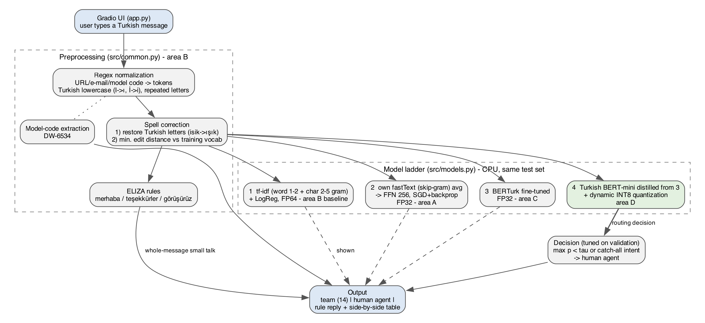

# Customer Support Ticket Router (SWE015 Homework, Use Case 2)

A support-message router for **Turkish** messages. Each message is normalized, its intent is predicted with a confidence score, and the message is sent to one of 14 teams. Low-confidence messages and the catch-all intent go to a **human agent**, and greetings or thanks get a rule-based reply. Four models of increasing sophistication run side by side, and the **distilled, INT8-quantized Turkish Transformer** makes the final decision.



## Model ladder

| # | Model | Area | Precision |
|---|---|---|---|
| 1 | tf-idf (word 1–2 grams + character 2–5 grams) + logistic regression | B · classical NLP baseline | FP64 |
| 2 | Own skip-gram fastText (gensim, char 3–5 grams), averaged → feedforward net (256 hidden, ReLU, dropout), trained with SGD + backprop | A · neural network trained from scratch | FP32 |
| 3 | BERTurk (`dbmdz/bert-base-turkish-uncased`, `strip_accents=False`) fine-tuned for 53-way intent classification | C · Transformer | FP32 |
| 4 | Turkish BERT-mini (`ytu-ce-cosmos/turkish-mini-bert-uncased`) distilled from #3 (Hinton KD, T=2, α=0.5), then dynamic INT8 quantization (`Linear` INT8, embeddings 8-bit weight-only) | D · efficient models | INT8 |

Preprocessing is the same for all four models (`src/common.py`, area B):
- regex normalization: URL/e-mail/model codes become tokens, Turkish lowercase (I→ı, İ→i), repeated letters collapsed
- model-code extraction (e.g. `DW-6534`)
- restoring missing Turkish letters (`isiklari` → `ışıkları`)
- minimum-edit-distance spelling correction against the training vocabulary
- ELIZA-style whole-message rules for small talk

## Data

[MASSIVE 1.1](https://huggingface.co/datasets/AmazonScience/massive), `tr-TR` locale (FitzGerald et al., 2022, CC BY 4.0). MASSIVE has no out-of-scope class, so four scenarios (`cooking`, `takeaway`, `social`, `weather`) are removed from training. Their validation and test sentences are labelled out-of-scope: topics the router has never seen. That leaves 53 intents in 14 teams. Splits:
- train: 10,082 sentences
- validation: 2,033 sentences, of which 281 are out-of-scope
- test: 2,974 sentences, of which 391 are out-of-scope

No model has an out-of-scope output: a message goes to the human agent when the top probability is below a per-model threshold τ, or when the top intent is the catch-all `general_quirky`. Checkpoints and τ are chosen on `validation`. Every number in the results comes from `test`.

## Results

`python evaluate.py` regenerates [`results/results.md`](results/results.md). Misclassified test messages are listed in `results/errors.csv`.

Test split: MASSIVE 1.1 tr-TR test, 2974 messages (391 out-of-scope from held-out scenarios). Latency: mean of 200 single-message calls incl. preprocessing, Apple M4 CPU, 4 torch threads, batch size 1.

| model                       | precision      |   accuracy |   in-scope acc |   OOS recall |   size (MB) |   latency (ms) |   threshold |
|:----------------------------|:---------------|-----------:|---------------:|-------------:|------------:|---------------:|------------:|
| tf-idf + LogReg             | FP64           |      76.06 |          76.69 |        71.87 |        25.5 |           1.11 |        0.35 |
| fastText + FFN              | FP32           |      72.02 |          72.94 |        65.98 |        86.9 |           0.74 |        0.4  |
| BERTurk fine-tuned          | FP32           |      76.09 |          77.66 |        65.73 |       442.7 |          29.73 |        0.4  |
| BERTurk fine-tuned          | INT8 (dynamic) |      75.62 |          76.19 |        71.87 |       111.4 |           9.61 |        0.45 |
| Turkish BERT-mini distilled | FP32           |      77.84 |          80.53 |        60.1  |        46.3 |           2.3  |        0.5  |
| Turkish BERT-mini distilled | INT8 (dynamic) |      75.96 |          76.23 |        74.17 |        11.9 |           2.17 |        0.45 |

Rows 4 and 5 are ablations: the quantized teacher, and the student before quantization.
- MASSIVE's catch-all intent `general_quirky` ("bana bugünü anlat") has no owning team, and unseen topics land in it with high confidence. Routing it to a human agent raised out-of-scope recall of the app model from 43% to 74% on test, and overall accuracy went up from 75.3% to 76.0% (the threshold was re-tuned on validation).
- Distillation gives the speed: the student is 9.6× smaller and about 13× faster than BERTurk.
- INT8 quantization gives the size: 3.9× smaller for −1.9 points. On the M4 CPU it does not make the small student faster; on BERTurk it is 3× faster.
- Latency was measured with other processes running on the laptop and moves between runs (BERTurk 26–42 ms over four runs).

## Setup and run

```bash
python3.12 -m venv .venv && source .venv/bin/activate
pip install -r requirements.txt
python train.py        # trains all four models into models/ (about 20 minutes on an Apple M4)
python evaluate.py     # writes results/
python app.py          # http://127.0.0.1:7860
```

Model weights are not stored in this repository. `python train.py` rebuilds them with fixed seeds. Trained weights: WEIGHTS_LINK. Unzip them into the repository root (they unpack into `models/`) to skip training.

## Layout

```
app.py            Gradio application
train.py          trains tfidf / ffn / bert / distill stages
evaluate.py       same held-out test set for all models: accuracy, OOS recall, size, latency
src/common.py     data loading, normalization, Turkish letter restoration, edit-distance correction, ELIZA rules
src/models.py     the four models behind one predict_proba interface, INT8 quantization
docs/             architecture diagram (Graphviz source + PNG), slide builder
results/          evaluation outputs and training log
```
